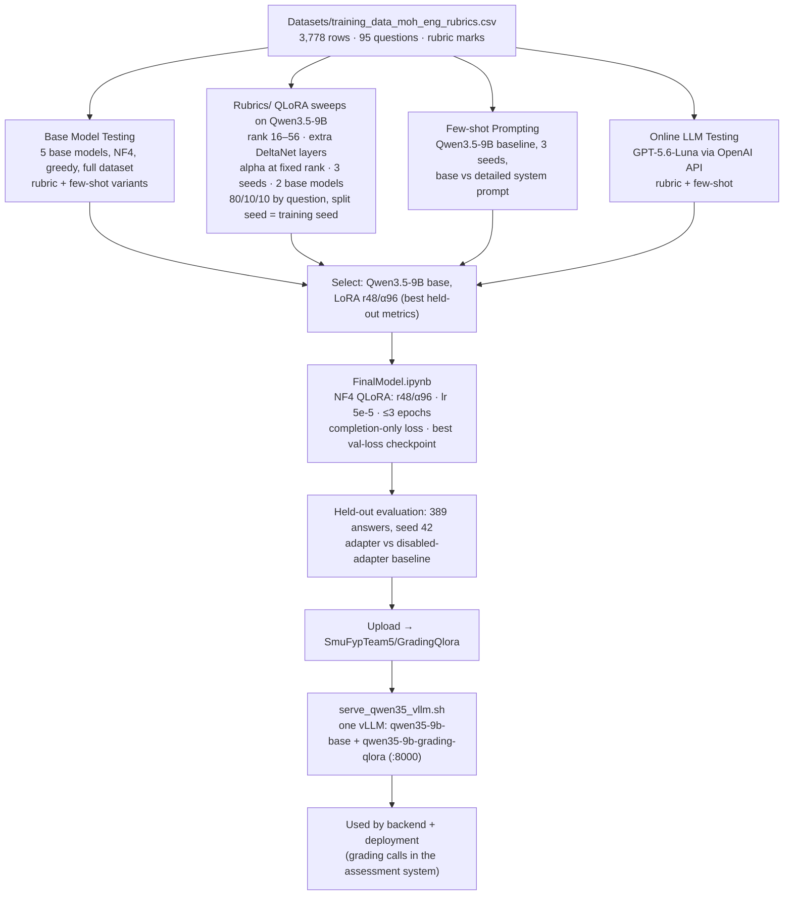
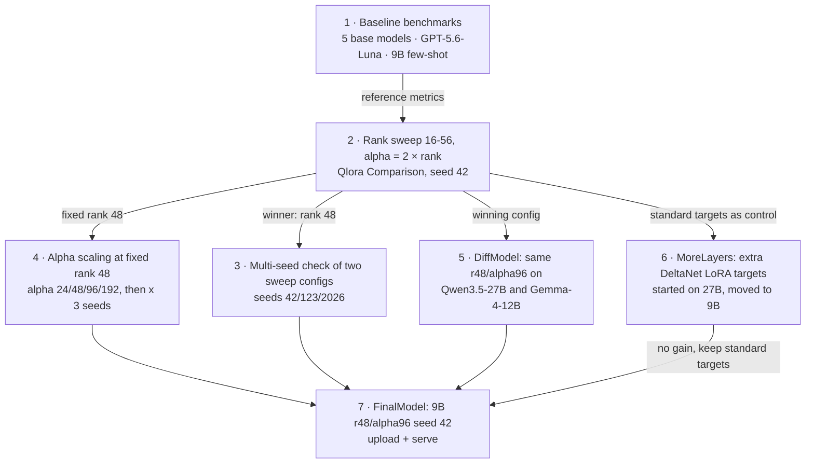

# Grading Model

This repository develops and evaluates the **grading QLoRA adapter** for
`Qwen/Qwen3.5-9B` used by the [backend](../backend) to grade short-answer
questions. Given a question, the desired answer, a student answer, and a
rubric, the trained model returns a strict JSON array of 0/1 labels — one
per criterion — and the backend converts those labels into a score. The
repo contains the dataset, the benchmarking notebooks, the hyperparameter
sweeps, the final model notebook, and a vLLM serving script. The winning
adapter is published to Hugging Face at
`SmuFypTeam5/GradingQlora` and served as
`qwen35-9b-grading-qlora` in the [deployment](../deployment).

## Experiment pipeline



## Experiment flow

The git history shows the repo developed in stages, each built on the
previous one's results (dates are commit dates):



1. **Baseline benchmarks** (September, `Base Model Testing/`,
   `Online LLM Testing/`, `Few-shot Prompting/`) — before any fine-tuning:
   five base models (Qwen3.5-4B/9B, Gemma-4-12B-it, Granite-4.2-8B,
   Ornith-1.5-9B) in rubric and few-shot variants (`Ran Base Models`, Sep
   22; the results folders also contain generations from an earlier
   27B-class run); GPT-5.6-Luna via the OpenAI API as the API-model ceiling
   (added Sep 21, rubric run Oct 2, few-shot run Oct 6); and few-shot
   prompting on Qwen3.5-9B itself — base and detailed system prompts,
   seeds 42/123/2026 (Oct 3–10) — the no-fine-tuning reference for the
   chosen base.
2. **Rank sweep** (Oct 1–9, `Rubrics/Qlora Comparison/`) — the first QLoRA
   experiments, on Qwen3.5-9B: ranks 16→56 with α = 2 × rank, seed 42.
   Result (`qlora_evaluation_comparison.csv`): **rank 48 / α96** leads on
   exact final-score accuracy (81.23%).
3. **Multi-seed check** (Oct 8, `Rubrics/Multi-seed/`) — built on the rank
   sweep's configurations: the 32r/64a and 48r/96a settings retrained on
   seeds 42/123/2026 (each seed from a fresh quantized base model and its
   own question split) to test seed stability.
4. **Alpha scaling at the winning rank** (Oct 17–21,
   `Rubrics/Scaling Comparison/`) — built on the rank-48 winner: rank fixed
   at 48 while α sweeps 24/48/96/192 (α/r = 0.5–4); `Scaling
   Multi-Seed` then re-checks the α = 24 and 96 ends across the three
   seeds, confirming α = 96.
5. **Different base models** (Oct 21–23, `Rubrics/DiffModel/`) — the
   winning r48/α96 configuration applied to Qwen3.5-27B and Gemma-4-12B-it;
   `model_comparison_r48_alpha96.csv` compares all three bases (baseline
   vs QLoRA) across seeds 42/123/2026, mean and per-seed.
6. **LoRA on more layers** (Oct 23 – Nov 3, `Rubrics/MoreLayers/`) — built
   on the sweep setup, initially on Qwen3.5-27B: `InProjQkv-OutProj` adds
   the DeltaNet linear-attention `in_proj` (q/k/v) and `out_proj`
   projections to the standard LoRA targets (ranks 32–48, then a 56–64
   companion notebook, α = 2 × rank, three seeds). On Oct 27 the notebooks
   were split into the 32–48 and 56–64 rank ranges and **moved to
   Qwen3.5-9B**; `InProjZ-InProjB-InProjA` (Oct 27–28) then tests adding
   the DeltaNet gate projections `in_proj_z/b/a` as well (ranks 24–48 and
   56–64). All runs on 9B completed by Nov 3.
7. **Final model** (Nov 4, `FinalModel.ipynb`) — first drafted for
   Qwen3.5-27B, reusing the 27B DiffModel experiment; switched to
   **Qwen3.5-9B r48/α96, seed 42** the same day on the strength of the 9B
   rank sweep. After documentation cleanups it was merged (Nov 11) and the
   adapter published to `SmuFypTeam5/GradingQlora` — the adapter served as
   `qwen35-9b-grading-qlora`.

## Project structure

| Path | Contents |
|---|---|
| [FinalModel.ipynb](FinalModel.ipynb) | Final training + held-out evaluation of the winning configuration; uploads the adapter. |
| `Base Model Testing/` | Pre-fine-tune benchmark of five base models on the full dataset (rubric and few-shot variants), plus `download_base_models.sh`. Results in `base_model_results/` and `base_model_results_fewshot/`. |
| `Datasets/` | The two working datasets (below). |
| `Few-shot Prompting/` | Qwen3.5-9B few-shot baseline (no fine-tuning), seeds 42/123/2026, base and detailed system prompts; results in `evaluation_results*/`. |
| `Online LLM Testing/` | GPT-5.6-Luna via the OpenAI API, rubric and few-shot; results in the two `*_results_gpt/` folders. |
| `Rubrics/` | QLoRA sweeps on Qwen3.5-9B: `Qlora Comparison/` (rank 16–56), `MoreLayers/` (added DeltaNet `in_proj`/`out_proj` targets), `Multi-seed/` (seeds 42/123/2026), `Scaling Comparison/` (alpha at fixed rank), `DiffModel/` (Qwen3.5-27B and Gemma-4-12B with the same adapter). |
| `serve_qwen35_vllm.sh` | One vLLM server exposing the base and the grading adapter. |
| `Archive/` | Past experiments (MLX-on-Mac attempts, the numbered Qwen3.5-9B development notebooks, an inference-only Colab deployment, older datasets). |

## Datasets

Both files cover the same 3,778 student answers to 95 unique questions
(~40 answers per question); array columns are JSON strings.

| File | Columns |
|---|---|
| `Datasets/training_data_moh_eng_rubrics.csv` | `id, question, desired_answer, student_answer, criteria[], criteria_score[], criteria_max_score[], student_score` |
| `Datasets/training_data_moh_eng_fewshot.csv` | `id, question, desired_answer, student_answer, max_score, student_score, examples` (one scored exemplar per possible score `0..max_score`) |

### Example and ground truth

Taken from `Datasets/training_data_moh_eng_rubrics.csv` (row ID `1.6`):

- **Question:** Where are variables declared in a C++ program?
- **Desired answer:** Variables can be declared anywhere in a program. They can
  be declared inside a function (local variables) or outside the functions
  (global variables).
- **Student answer:** They can be declared right before they are used, but it
  is a good practice to declare them at the beginning of the program and label
  what they are food.
- **Criteria:**
  1. Answer mentions variables can be declared anywhere in program.
  2. Answer mentions local variables can be declared inside functions.
  3. Answer mentions global variables can be declared outside functions.
- **Ground truth:** `[1, 0, 0]`

## Training method (all rubrics experiments)

Every QLoRA run shares the same recipe (see `FinalModel.ipynb`):

- Base: `Qwen/Qwen3.5-9B`, 4-bit NF4 with double quantization, bf16, one GPU.
- LoRA on the q/k/v/o and gate/up/down projections of the text layers,
  dropout 0.05, `bias="none"`.
- SFT with completion-only loss: the model sees the grading prompt
  (system: "strict grading assistant" returning only a JSON array of 0/1;
  user: question, desired answer, student answer, numbered criteria) and
  learns the ground-truth label array. Thinking is disabled.
- 80/10/10 split **by unique question** (all answers to a question stay in
  one split), split seed equal to the training seed: seeds 42/123/2026 give
  389/278/396 held-out answers.
- paged-AdamW-8bit, learning rate 5e-5 with plateau reduction, up to 3
  epochs, early stopping (patience 4), four validations per epoch, and the
  checkpoint with the lowest validation loss is evaluated.
- Evaluation: greedy decode, strict JSON-array parsing (with a recovery
  path reported separately), and a fixed metric set: invalid/recovered
  output rate, exact rubric-array accuracy, per-criterion accuracy,
  precision/recall/F1, final-score exact / within-one accuracy, MAE, RMSE,
  Pearson, and quadratic-weighted kappa (final score = Σ label × criterion
  max). The same rows are scored again with the adapter disabled to
  report the fine-tuning delta.

## Results

**Final model** (seed 42, 389 held-out answers; recorded in
`FinalModel.ipynb` and `Rubrics/Qlora Comparison/qlora_evaluation_comparison.csv`):

| Metric | Base (adapter disabled) | Final adapter (r48/α96) |
|---|---|---|
| Final-score exact accuracy | 74.04% | **81.23%** |
| Exact rubric-array accuracy | 74.04% | 80.46% |
| Final-score MAE | 0.3085 | 0.2108 |
| Final-score Pearson | 0.8083 | 0.8584 |
| Final-score QWK | 0.8013 | 0.8557 |

The rank sweep picked **rank 48 / alpha 96** as the best configuration;
expanding the LoRA targets to the DeltaNet projections and changing the base
model (DiffModel) did not beat it. The few-shot baseline on the same base
model reached 62.5% final-score exact (detailed prompt, seed 42) and the
GPT-5.6-Luna API 67.4% — both below the fine-tuned adapter.

## Install the vLLM server

Python 3.12 and an NVIDIA GPU with a compatible driver are required. Create
a dedicated environment and install the pinned serving dependencies:

```bash
uv venv --python 3.12 .venv-vllm
source .venv-vllm/bin/activate
uv pip install -r requirements-vllm.txt
```

Then start the quantized base model and QLoRA adapter:

```bash
LORA_PATH=SmuFypTeam5/GradingQlora VLLM_MAX_LORA_RANK=48 ./serve_qwen35_vllm.sh
```

The script serves one vLLM process with two selectable model names on port
8000: `qwen35-9b-base` (adapter disabled) and `qwen35-9b-grading-qlora`
(adapter enabled), with 4-bit bitsandbytes loading. `LORA_PATH` accepts a
local adapter directory or a Hugging Face repo ID; the final adapter has
rank 48, so set `VLLM_MAX_LORA_RANK` to at least 48 (the script default is
16). List both models with `curl http://127.0.0.1:8000/v1/models`.

## Compare the base and QLoRA models

Send the same grading request to both model aliases; the difference is only
the `model` field.

```bash
curl -s http://127.0.0.1:8000/v1/chat/completions \
  -H "Content-Type: application/json" \
  -d '{
    "model": "qwen35-9b-base",
    "messages": [
      {
        "role": "system",
        "content": "You are a strict grading assistant. Evaluate whether the student answer fulfills each grading criterion independently. Return ONLY a valid JSON array containing 0 or 1, with exactly one value per criterion in the same order. Do not include explanations or markdown."
      },
      {
        "role": "user",
        "content": "Question:\nWhere are variables declared in a C++ program?\n\nDesired answer:\nVariables can be declared anywhere in a program. They can be declared inside a function (local variables) or outside the functions (global variables).\n\nStudent answer:\nThey can be declared right before they are used, but it is a good practice to declare them at the beginning of the program and label what they are food.\n\nCriteria:\n1. Answer mentions variables can be declared anywhere in program\n2. Answer mentions local variables can be declared inside functions\n3. Answer mentions global variables can be declared outside functions"
      }
    ],
    "temperature": 0,
    "max_tokens": 128,
    "chat_template_kwargs": { "enable_thinking": false }
  }' | python -m json.tool
```

Repeat with `"model": "qwen35-9b-grading-qlora"` for the adapter. The
generated grading array is returned in `choices[0].message.content`.
